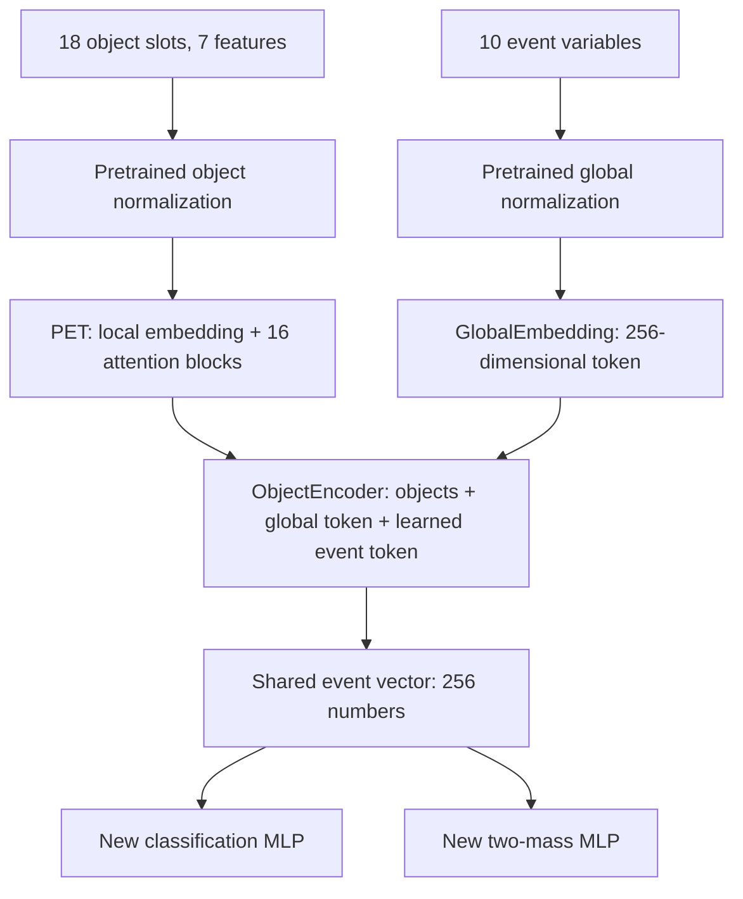

# Final architecture of the testing prototype

We reuse a pretrained event representation and learn two new tasks for
Suu -> chi chi. This is transfer learning from EveNet, not a new foundation-model
pretraining campaign. The present implementation estimates one common chi mass
and one parent Suu mass per event. It does not reconstruct two separate chi
four-vectors, assign jets to parents, or identify which jet an old algorithm
assigned incorrectly.

## Inputs and normalization

For a batch of B events:

| Input | Shape | Content |
|---|---|---|
| Objects | B x 18 x 7 | E, pt, eta, phi, categorical btag, isLepton, charge |
| Object validity | B x 18 | True for real objects, False for padding |
| Global variables | B x 10 | MET, MET phi, nLepton, nbJet, nJet, HT, HT_lep, M_all, M_leps, M_bjets |

Our initial converter uses selected AK4 jets. It orders them by pt, retains at
most 18, and pads shorter events with zeros. This ordering is for input storage
and truncation, not grouping jets into two chi candidates. The binary btag
decision is formed from DeepJet using the supplied era-specific working point;
the original continuous score is not passed to this checkpoint's categorical slot.

The model receives raw GeV features. It applies log1p to E and pt, and to MET,
HT, HT_lep, M_all, M_leps and M_bjets. It then uses the released checkpoint's means,
standard deviations and normalization masks. The object phi feature also uses
the upstream inverse-normal-CDF transformation. No normalization statistics are
estimated from validation/test events. The stored global M_all is a reconstructed
invariant mass; it is available on data and is not the true Suu mass.

## Shared pretrained network

**GlobalEmbedding:** a stack of upstream GRU-gated feed-forward blocks maps the
ten event variables to one token of width 256. Here GRU refers to the gating in
these blocks; this is not a temporal sequence of collision events.

**PET:** each input object is embedded to width 256. The local embedding uses
10 local layers with K=3 neighbors; the initial local-coordinate indices are eta
and phi in the normalized object input. It then applies 16 transformer blocks,
each with 16 attention heads. Attention mixes information among objects in the
same event. The local embedding is upstream code and is not a hand-built table
of jet-pair invariant masses. We do not call this Particle Transformer's exact
pairwise-interaction-bias implementation.

**ObjectEncoder:** the object tokens and global token are combined, a learned
event token is included, and two encoder layers with 8 attention heads produce
the final event representation. The output event token has 256 components.

All three modules are initialized from the public checkpoint. The deterministic
path has time=0, no diffusion noise, and no feature random dropping. Other
configured dropout is active during fine tuning and disabled at inference.

## New task heads

Both heads begin with Linear(256,128), then GELU. The classification head ends
in Linear(128,1); the regression head ends in Linear(128,2).

Let h be the shared event vector. The raw outputs are:

- z = event_head(h), a signal logit;
- r_chi, r_Suu = mass_head(h), predictions in log-mass space.

The physical outputs are:

$$s=\operatorname{sigmoid}(z),\qquad
\widehat m_\chi=1000\exp(r_\chi)\ {\rm GeV},\qquad
\widehat m_{S_{uu}}=1000\exp(r_{S_{uu}})\ {\rm GeV}.$$

The heads are randomly initialized before downstream training. The masses are
positive by construction; no explicit m_Suu > 2 m_chi constraint is imposed.
There is no uncertainty-prediction head. The score is not guaranteed to be a
calibrated physical signal probability because training composition/weights affect it.
We omit upstream diffusion, assignment, segmentation and process-classification
heads. A full-framework import is not required: we directly instantiate its
actual backbone modules and use a small task-specific trainer.

## Targets and objective

The supervised label is y=1 for signal and y=0 for every background process,
including all QCD HT slices. Signal masses are the generated mass parameters
for that sample. They are targets, never inputs. Background mass targets may be
NaN and are selected out before taking logs or evaluating regression loss.

For nonnegative training weights w_i:

$$L_{cls}=\frac{\sum_i w_i\,\mathrm{BCEWithLogits}(z_i,y_i)}{\sum_i w_i}.$$

Define u_ia = log(m_ia_true / 1000 GeV). For the two targets a:

$$L_{mass}=\frac{\sum_{i:y_i=1}w_i\frac12\sum_{a\in\{\chi,S_{uu}\}}
\mathrm{SmoothL1}(r_{ia}-u_{ia})}{\sum_{i:y_i=1}w_i}.$$

SmoothL1 uses beta=1: 0.5*d^2 for |d|<1 and |d|-0.5 otherwise.
The total is L_cls + lambda*L_mass, with lambda=1 as the initial default.
An all-background batch contributes zero mass loss. A zero weight sum produces
zero contribution for that term. Signed physics weights for yield templates
must be handled separately; this trainer rejects negative training weights.

The two heads and shared encoder train jointly. Background does not directly
supervise a chi mass, but its classification gradients can change the encoder
and thus indirectly change mass predictions. There is no gate that turns off
the mass head on background. Its background output is a learned discriminating
observable, whose distribution must be modeled before a search fit.

## Training, validation and inference

The default is 20 epochs. Epochs 1-2 freeze the backbone and train the new heads;
backbone dropout is off then. Epochs 3-20 unfreeze the backbone. AdamW uses
head LR=1e-3, backbone LR=1e-5, weight decay=0.01, gradient norm clipping=1.
Validation runs without gradients/dropout and chooses the minimum joint
validation loss. These are starting settings, not optimized physics results.

Event keys determine a stable 70/15/15 train/validation/test split. Duplicates
within a dataset and train/validation overlaps are rejected. The key namespace
must preserve physical event identity across skims and systematic copies.
Holding out entire mass points is a separate necessary test of interpolation;
the default random event split does not establish that ability.

Inference loads the complete fine-tuned checkpoint, applies the same feature
transforms, and outputs a score plus both masses for every event. It does not
read labels or truth masses. Predictions can be joined to original events using
event_key for plotting or constructing statistical templates.
